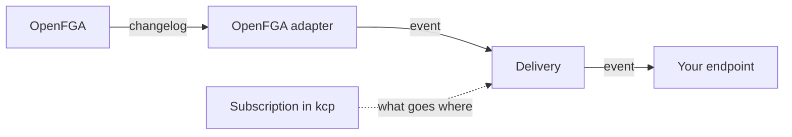

# Platform Mesh Eventing

Eventing lets other systems react to what happens in Platform Mesh without polling it.

Today, when someone is added to an account, a user logs in, or a provider changes a resource, nothing tells anyone else. Every system that cares has to poll OpenFGA, Keycloak or kcp itself, map the data on its own, and handle retries. This repository adds an optional module that turns those changes into [CloudEvents](https://cloudevents.io) and delivers them to subscribers.

## How it works



OpenFGA can't send events, so the adapter reads its changelog and turns a change like "Alice became member of team-a" into an event. You create a Subscription in your org's kcp workspace (which events, which URL), and delivery sends matching events there, with retries.

Later more systems get adapters (Keycloak, kcp), and providers will be able to send their own events too.

More detail: [architecture](docs/architecture.md), [event contract](docs/contract.md), [decisions](docs/adr/).

## What it does not do

- It does not change any existing Platform Mesh component. Eventing observes the system from outside and can be installed or removed independently.
- It does not connect to message brokers on the subscriber side. A subscriber that needs GCP Pub/Sub, Kafka or similar runs its own bridge behind an HTTP endpoint.

## First milestone

- Membership events (a user gets or loses a role on an account), read from OpenFGA.
- Subscriptions per org.

What comes after is in the [roadmap](docs/roadmap.md).

## Try it locally

You need a local Platform Mesh on kind, installed as described in
[helm-charts/installation](https://github.com/platform-mesh/helm-charts/tree/main/installation),
and `kubectl`, `docker`, `curl` and `jq`.

```sh
./hack/install.sh     # adds eventing and a demo org eventing-demo with a subscribed sink
./hack/add-member.sh  # gives a user the member role on the demo org
kubectl -n eventing-demo-sink logs deploy/event-display
```

The sink shows a `membership.granted` event. `./hack/add-member.sh --remove`
takes the role away again, `./test/e2e.sh` checks the whole path and
`./hack/uninstall.sh` removes everything.

## Background

- Epic: [platform-mesh/backlog#323](https://github.com/platform-mesh/backlog/issues/323)
- Spike and results: [platform-mesh/backlog#421](https://github.com/platform-mesh/backlog/issues/421)
- Modularization: [RFC 008](https://github.com/platform-mesh/architecture/blob/main/rfc/008-platform-mesh-modularization.md)
