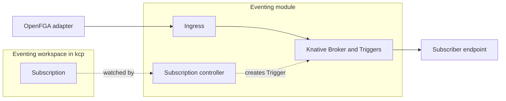

# Architecture

This page explains the parts of the eventing module and how an event travels through them. The reasons behind the choices are in the [decision records](adr/).

## The parts

| Part | What it does | Who builds it |
| --- | --- | --- |
| OpenFGA adapter | Reads the OpenFGA changelog and turns membership changes into events, plus a snapshot of the members of each changed account | us |
| Ingress | Checks who is sending, then hands the event to the broker. Reachable through the platform's Gateway | us |
| Subscription API | A kcp resource for platform admins in `root:providers:eventing`: event types, optional orgs, target URL, retry settings | us |
| Subscription controller | Checks the sink against the operator's allowlist, turns each Subscription into a Knative Trigger and reports status back | us |
| Delivery | Fan-out, filtering by type, retries, dead letters | Knative Eventing, with NATS JetStream as the broker's channel |

## An event, step by step

Example: Alice is made a member of account `team-a` in org `acme`.

1. Someone adds Alice in the portal, and iam-service writes a role tuple to OpenFGA. Nothing in that path knows about eventing.
2. The OpenFGA adapter polls the changelog of the `acme` store, sees the new tuple, and builds a `membership.granted` event ([contract](contract.md)).
3. The adapter posts the event to the ingress. The ingress checks the adapter's identity and forwards the event to the broker.
4. A Subscription asked for membership events (of all orgs, or of `acme`). Its Trigger matches, and Knative sends the event to the subscriber's URL.
5. If the subscriber does not answer with success, Knative retries with backoff. After the last attempt the event goes to a dead letter sink, if one is set.

## Tenancy

Subscriptions are for platform admins. They live in the provider workspace `root:providers:eventing`, which binds its own export. The export has no `APIExportPolicy`, so orgs cannot bind it.

One broker carries the events of all orgs. Every event names its org in `pmorg`, and a Subscription can be limited to some orgs.

Org-level and account-level subscriptions are not in the first milestone.

## How it plugs in

The module does not change Platform Mesh components. It needs:

- an APIExport for the Subscription API, bound in its own workspace;
- read access to the OpenFGA changelog and tuples;
- read access to `AccountInfo` through the `core.platform-mesh.io` export, for account paths: a provider connection like the one iam-service gets;
- Knative Eventing and its NATS JetStream channel in the cluster, used by eventing only. A NetworkPolicy lets only our ingress reach Knative's broker ingress, and that ingress is shared by every broker in the cluster;
- an HTTPRoute on the platform's Gateway, so publishers outside the cluster can reach the ingress.

If eventing is not installed, Platform Mesh works exactly as before.

## Delivery guarantees

- At least once: a subscriber can get the same event more than once and should ignore duplicates by event `id`.
- No ordering across events. In particular a role change arrives as two events (revoked and granted) in any order.
- The broker's channel stores an event in NATS JetStream before the broker accepts it. Every Trigger reads the stream on its own, so a subscriber that keeps failing only delays itself, and a restart of the channel dispatcher or of NATS loses nothing.
- The stream keeps events for a day and at most 512 MiB. The local setup runs a single NATS server; production wants a NATS cluster.
- A Trigger gets the events published after it was created, not the ones before. Knative recreates a Trigger's channel subscription when its delivery settings change, and events published in that moment are missed by that Trigger.

## Known gaps

These came out of the [spike](https://github.com/platform-mesh/backlog/issues/421) and are open work:

- The Knative broker ingress accepts any event from inside the cluster, which is why our own ingress sits in front of it. A NetworkPolicy lets only our ingress reach the broker ingress.
- The ingress accepts only the platform's own adapters so far. Providers publishing events for their orgs is not built yet.
- Replies are blocked by the same NetworkPolicy. If a subscriber answers with a CloudEvent, Knative's broker filter tries to send it to the broker ingress, which doesn't let it in; the filter retries for a while and drops it. Knative OIDC with an EventPolicy per broker would reject replies properly, but it is alpha and switched on for the whole cluster.
- The ingress is reachable at `eventing.services.<domain>` through the `terminate-services` listener of the platform Gateway. In the kind setup the platform certificate covers `*.<domain>` but not `*.services.<domain>`, so that host gets Traefik's default certificate.
