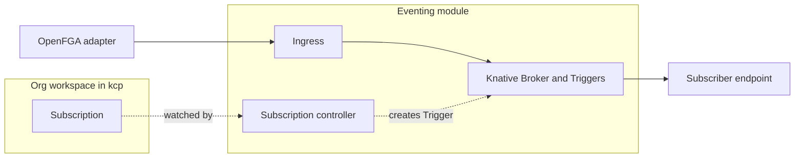

# Architecture

This page explains the parts of the eventing module and how an event travels through them. The reasons behind the choices are in the [decision records](adr/).

## The parts

| Part | What it does | Who builds it |
| --- | --- | --- |
| OpenFGA adapter | Reads the OpenFGA changelog and turns membership changes into events | us |
| Ingress | Checks who is sending and that the event belongs to that sender's org, then hands it on | us |
| Subscription API | A kcp resource in the org workspace: event types, target URL, retry settings | us |
| Subscription controller | Turns each Subscription into a Knative Trigger and reports status back | us |
| Delivery | Fan-out, filtering by type, retries, dead letters | Knative Eventing |

## An event, step by step

Example: Alice is made a member of account `team-a` in org `acme`.

1. Someone adds Alice in the portal, and iam-service writes a role tuple to OpenFGA. Nothing in that path knows about eventing.
2. The OpenFGA adapter polls the changelog of the `acme` store, sees the new tuple, and builds a `membership.granted` event ([contract](contract.md)).
3. The adapter posts the event to the ingress. The ingress checks the adapter's identity and forwards the event to the broker of `acme`.
4. A Subscription in `acme` asked for membership events. Its Trigger matches, and Knative sends the event to the subscriber's URL.
5. If the subscriber does not answer with success, Knative retries with backoff. After the last attempt the event goes to a dead letter sink, if one is set.

## Tenancy

Each org is isolated. An org gets its own broker, and a Subscription only ever receives events of its own org. Subscriptions live in the org workspace, so who may create them is controlled by normal kcp permissions.

Account-level and installation-wide subscriptions are not in the first milestone.

## How it plugs in

The module does not change Platform Mesh components. It needs:

- an APIExport for the Subscription API that orgs bind to, with a permission
  claim on `logicalclusters`. The controller reads the workspace path from it,
  which gives it the org name;
- read access to the OpenFGA changelog;
- Knative Eventing installed in the cluster.

If eventing is not installed, Platform Mesh works exactly as before.

## Delivery guarantees

- At least once: a subscriber can get the same event more than once and should ignore duplicates by event `id`.
- No ordering across events. In particular a role change arrives as two events (revoked and granted) in any order.
- The in-memory channel used for development loses events on restart. Production needs a durable broker class such as Kafka.

## Known gaps

These came out of the [spike](https://github.com/platform-mesh/backlog/issues/421) and are open work:

- The Knative broker ingress accepts any event from inside the cluster, which is why our own ingress sits in front of it.
- Subscriptions accept any URL. Targets should be limited by an allowlist that the platform operator controls.
